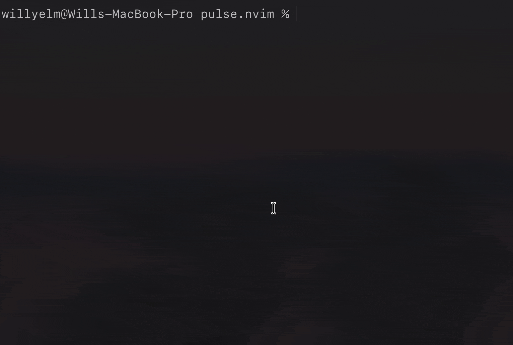

# Pulse.nvim

One entry point. Total focus.



## What is Pulse

A fast command palette for Neovim. Pulse uses a prefix approach to move quickly
between navigator modes:

| Prefix      | Mode                          |
| ----------- | ----------------------------- |
| (no prefix) | files                         |
| `'`         | marks (yours: A-Z and a-z)    |
| `:`         | commands                      |
| `~`         | git                           |
| `$`         | live grep                     |
| `?`         | fuzzy search (current buffer) |
| `@`         | symbols (current buffer)      |
| `#`         | workspace symbols             |
| `!`         | diagnostics                   |
| `>`         | code actions (current buffer) |

For more on the design motivation, see:

- [Engineering with machines](https://willmedina.com/blog/engineering-with-machines)
- [A Single Command Palette for Neovim](https://willmedina.com/blog/pulse-neovim)

## Requirements

- Neovim `>= 0.12`
- `ripgrep` (`rg`)
- `git` (for git panels and previews)
- `nvim-tree/nvim-web-devicons` (optional, recommended)

## Install (vim pack)

```lua
vim.pack.add("https://github.com/willyelm/pulse.nvim")
require("pulse").setup({})
```

## Install (lazy.nvim)

```lua
{
  "willyelm/pulse.nvim",
  dependencies = { "nvim-tree/nvim-web-devicons" },
  opts = {},
}
```

## Setup

```lua
require("pulse").setup({
  cmdline = true, -- Enable experimental ':' cmdline replacement
  position = "top",
  width = 0.70,
  height = 0.90,
  border = "rounded",
  workspace_label = false, -- Show workspace dir in main input
  keys = { fullscreen = "<C-f>" }, -- toggle fullscreen; another key, or false for none
})
```

`keys.fullscreen` is handled inside Pulse's input, so it can't be bound from
your own mappings.

## Navigators

Navigators are the different modes you can enter in Pulse. Each navigator has
its own data source, display, and actions.

You can configure which navigators to load and their config options.

**Default navigators** (all loaded if not specified), and the command that opens each:

| Command | Navigator | Shows |
| --- | --- | --- |
| `:Pulse` | | Toggle Pulse |
| `:Pulse files` | `files` | Project files and opened buffers |
| `:Pulse marks` | `marks` | Your marks (`A`-`Z`, plus `a`-`z` in the current buffer) |
| `:Pulse commands` | `commands` | Vim commands |
| `:Pulse git` | `git` | Changes (status, diff, stage, commit, restore), branches, project and file history |
| `:Pulse git_review` | `git` | The [review tab](#git-review) for the current buffer |
| `:Pulse live_grep` | `live_grep` | Ripgrep search with `-g` globs and search-and-replace (see [Live Grep](#live-grep)) |
| `:Pulse fuzzy_search` | `fuzzy_search` | Fuzzy search (current buffer) |
| `:Pulse symbols` | `symbols` | Symbols (current buffer) |
| `:Pulse workspace_symbols` | `workspace_symbols` | Workspace symbols |
| `:Pulse diagnostics` | `diagnostics` | LSP diagnostics |
| `:Pulse code_actions` | `code_actions` | Code actions (current buffer) |

### Navigator keys

**files**

| Key | Action |
| --- | --- |
| `<C-a>` | Add a file or folder (asks with `vim.ui.input`) |
| `<C-r>` | Rename (asks with `vim.ui.input`) |
| `<C-d>` | Delete (asks with `confirm()`) |
| `<C-c>` / `<C-x>` | Copy / cut |
| `<C-v>` | Paste |

**marks**

| Key | Action |
| --- | --- |
| `<C-x>` | Delete the mark |

**git**

| Key | On | Action |
| --- | --- | --- |
| `<CR>` | changed file | Open the [review tab](#git-review) |
| `<C-o>` | changed file | Open the file alone |
| `<C-c>` | status panel | Commit: opens a `gitcommit` buffer (`:w` commits, `:q` aborts), then the panel comes back |
| `<CR>` | branch | Check it out (a remote branch is tracked, creating the local branch the first time) |
| `<Tab>` | branch | Browse its history as a scoped view; the row at the top goes back |
| `<C-d>` | local branch | Delete with `git branch -d` (unmerged or checked-out-elsewhere branches are refused) |

A remote branch identical to its local copy isn't listed. Remote branches
can't be deleted from here.

### Git review

A tab with the staged version (left) and the whole working file (right) in
native diff mode. The right side is your normal buffer: edit and `:w` as usual.
Changes written to disk by another tool (e.g. an AI agent) reload live.

Open it with `<CR>` on a changed file in the git status panel, or
`:Pulse git_review` for the current buffer.

| Key | Action |
| --- | --- |
| `]c` / `[c` | Next / previous hunk |
| `]f` / `[f` | Next / previous changed file |
| `do` | Revert the hunk to the staged version |
| `dp`, then `:w` in the left pane | Stage that hunk |
| `<leader>s` | Save and stage the whole file |
| `<leader>v` | Mark the file viewed and jump to the next unviewed one |
| `zi` | Fold / unfold unchanged lines |
| `q` | Close |

Editing a file after marking it viewed clears the mark.

To load a specific set only:

```lua
require("pulse").setup({
  navigators = { "files", "commands", "git" },
})
```

Each navigator can receive its own config directly through `navigators`:

```lua
require("pulse").setup({
  navigators = {
    files = {
      icons = false,
      filters = { "^%.git$", "%.DS_Store$" },
      git = {
        enable = true,
        ignore = false,
      },
    },
  },
})
```

Current `files` options:

- `icons`
- `icon_color`
- `filters`
- `git.enable`
- `git.ignore`
- `open_on_directory`
- `tree_view` (default `true`; set `false` for a flat, Telescope-style file list
  with no folder browsing)

## Files Navigator

Pulse files navigator shows project files and opened buffers. It can be used as
a file explorer and replace netrw.

### Setup as Default Tree

To open Pulse files instead of netrw for directory buffers like `nvim .`, set
the netrw globals before setup and enable `open_on_directory` on the files
navigator:

```lua
-- Set in your vim config
vim.g.loaded_netrw = 1
vim.g.loaded_netrwPlugin = 1
-- Plugin
require("pulse").setup({
  navigators = {
    files = {
      open_on_directory = true,
    },
  },
})
```

With `lazy.nvim`:

```lua
-- Set in your vim config
vim.g.loaded_netrw = 1
vim.g.loaded_netrwPlugin = 1
-- Lazy plugin config
{
  "willyelm/pulse.nvim",
  lazy = false,
  dependencies = {
    "nvim-tree/nvim-web-devicons",
  },
  opts = {
    cmdline = true,
    position = "top",
    height = 0.9,
    width = 0.7,
    workspace_label = false,
    navigators = {
      files = {
        open_on_directory = true,
      },
    },
  },
}
```

## Live Grep

Type `$` followed by what to search for. The search is ripgrep's own regex, with
smart case (all lowercase ignores case, any uppercase makes it exact).

### Include and exclude files

Add ripgrep's own `-g` (`--glob`) flag to the query, as many times as needed. A
glob starting with `!` excludes:

| Query                              | Searches                      |
| ---------------------------------- | ----------------------------- |
| `$foo -g *.lua`                    | only Lua files                |
| `$foo -g !*.test.ts`               | everything except test files  |
| `$foo -g src/** -g !src/vendor/**` | `src/`, without `src/vendor/` |

These are globs (`*`, `**`, `?`, `{a,b}`), not regexes, same as VS Code's files
to include and exclude. `-g` is the only flag Pulse reads; anything else is part
of the search text.

### Replace

With a search typed, `<C-r>` enters replace for it. Same as opening a folder in
Files, it becomes a scoped view: the search moves into the input's label, every
other panel hides, and the input takes the replacement. `<BS>` on an empty
replacement goes back to the search.

Matches are grouped under their file, and every row shows what goes (gray) next
to what replaces it (magenta). The preview shows the same as a diff, in the
file's own context. It is ripgrep's own `--replace`, so capture groups work:
searching `foo_(\d+)` and replacing with `bar$1` turns `foo_12` into `bar12`.

The keys there only replace:

| Key               | Action                                  |
| ----------------- | --------------------------------------- |
| `<CR>` on a file  | Replace every match in that file        |
| `<CR>` on a match | Replace just that one                   |
| `<C-a>`           | Replace everything, after a `confirm()` |

Replaced rows leave the list, and the next one is selected.

- Files open in Neovim are edited in their buffer, so `u` undoes it, and saved
  unless they already had unsaved edits of their own.
- Other files are rewritten on disk directly, without loading them.
- A line that changed since the search is skipped (and reported), never replaced
  in the wrong place.
- `-g` filters in the search carry over: only the files it searched are
  replaced.

## Open Pulse

Every `:Pulse` command is listed in the [Navigators](#navigators) table.

## Input + Navigation

- `<Down>/<C-n>`: next item (from input)
- `<Up>/<C-p>`: previous item (from input)
- `<Left>/<Right>`:
  - from input: switch panels when the cursor is at the end of the input
  - from list: switch panels directly
- `Esc`: close navigator
- `<Tab>`:
  - files:
    - folder: enter folder scope
    - file: preview in source window and enter buffer scope
  - symbols/workspace symbols: jump to location (navigator stays open)
  - live grep/fuzzy search: open/jump to location (navigator stays open)
  - diagnostics: jump to location (navigator stays open)
  - marks: jump to the mark (navigator stays open)
  - commands: replace input with selected command
  - git: preview/jump depending on the current git panel item
- `<CR>`: submit/open and close navigator
- selection wraps from last->first and first->last

When a scope token is present:

- first backspace removes the current panel prefix
- next backspace removes the scope token

In `commands` mode:

- No implicit first-item execution.
- `<CR>` executes the selected command only after explicit navigation.
- Otherwise `<CR>` executes the typed command.

## Optional Keymaps

```lua
vim.keymap.set("n", "<leader>p", "<cmd>Pulse<cr>", { desc = "Pulse" })
vim.keymap.set("n", "<leader>pg", "<cmd>Pulse git<cr>", { desc = "Pulse Git" })
vim.keymap.set("n", "<leader>pb", "<cmd>Pulse buffers<cr>", { desc = "Pulse Buffers" })
vim.keymap.set("n", "<leader>pd", "<cmd>Pulse diagnostics<cr>", { desc = "Pulse Diagnostics" })
vim.keymap.set("n", "<leader>pc", "<cmd>Pulse code_actions<cr>", { desc = "Pulse Code Actions" })
vim.keymap.set("n", "<leader>ps", "<cmd>Pulse symbols<cr>", { desc = "Pulse Symbols" })
vim.keymap.set("n", "<leader>pw", "<cmd>Pulse workspace_symbols<cr>", { desc = "Pulse Workspace Symbols" })
vim.keymap.set("n", "<leader>pl", "<cmd>Pulse live_grep<cr>", { desc = "Pulse Live Grep" })
vim.keymap.set("n", "<leader>pf", "<cmd>Pulse fuzzy_search<cr>", { desc = "Pulse Fuzzy Search" })
```

## Theming

Pulse mostly uses native Neovim highlight groups for color:

- `DiffAdd`
- `DiffDelete`
- `DiffChange`
- `Directory`
- `LineNr`
- `Title`

Pulse-specific groups are only used where it needs custom UI treatment:

- `PulseAction` - The copied or cut label on a file or folder (links to
  `Keyword` by default)
- `PulseDiffAdd`
- `PulseDiffDelete`
- `PulseDiffNAdd` - Secondary background for added lines in diff
- `PulseDiffNDelete` - Secondary background for deleted lines in diff
- `PulseReplaceOld` - Live grep replace: the text being replaced (gray)
- `PulseReplaceNew` - Live grep replace: its replacement (magenta)
- `PulseDiffMatch` - Live grep replace preview: background of the line being
  replaced
- `PulseDiffReplace` - Live grep replace preview: background of its replacement

The replace colors default to your theme's own gray and magenta, with the
preview backgrounds mixed into its `Normal` background; set them for a theme
with a transparent background.

Example:

```lua
vim.api.nvim_set_hl(0, "PulseDiffAdd", { link = "DiffAdd" })
vim.api.nvim_set_hl(0, "PulseDiffDelete", { link = "DiffDelete" })
```

## Contributing

[See CONTRIBUTING.md](./CONTRIBUTING.md)

## Changelog

[See CHANGELOG.md](./CHANGELOG.md)
